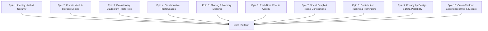

# .4to — Epics & User Stories Specification

> **Private-first, full-fidelity shared photo platform. Every photo. Every friend. Zero compression.**

This document provides a comprehensive breakdown of the entire **.4to** platform divided into high-level **Epics**, granular **User Stories** (using the standard format: *As a... I want to... So that...*), and explicit **Acceptance Criteria**.

---

## 📋 Epic Hierarchy Overview

---

## 🛡️ Epic 1: Identity, Authentication & Security
*Core account creation, authentication, role-based identity, session security, and Two-Factor Authentication (2FA).*

### Story 1.1: User Registration with Unique Username
- **As a** new user,
- **I want to** register with my email, password, display name, and a unique `@username`,
- **So that** I have a distinct personal identity on the platform and friends can discover me.
- **Acceptance Criteria:**
  - Email addresses must be valid format and unique.
  - Usernames must match `^[a-zA-Z0-9_]{3,30}$` and be case-insensitively unique.
  - Passwords are validated for at least 8 characters and hashed with Argon2id.
  - Instant live availability checking on username entry (`GET /v1/users/check-username`).

### Story 1.2: Secure Login & Token Refresh
- **As a** registered user,
- **I want to** authenticate with my credentials and receive stateless JWT tokens,
- **So that** I remain logged in securely without exposing credentials on every request.
- **Acceptance Criteria:**
  - Login issues a short-lived `access_token` (15 minutes) and a long-lived `refresh_token` (30 days).
  - Rate limiting enforces a maximum of 15 attempts per minute per IP/account to prevent brute forcing.
  - Revocation or logout clears local tokens.

### Story 1.3: Two-Factor Authentication (TOTP 2FA) Setup
- **As a** security-conscious user,
- **I want to** enable Two-Factor Authentication using an authenticator app (Google Authenticator, 1Password, Authy),
- **So that** my uncompressed photo vault is protected against unauthorized password breaches.
- **Acceptance Criteria:**
  - System generates a secure TOTP secret key and renders an SVG QR code along with a copyable manual key.
  - User must enter a valid 6-digit TOTP verification code to confirm activation.
  - System generates and presents 6 single-use emergency backup recovery codes (`xxxx-xxxx`).
  - Active status displays a verified lime badge in Profile Settings.

### Story 1.4: 2FA Sign-In Challenge
- **As a** user with 2FA enabled,
- **I want to** be prompted for my 6-digit authenticator code (or backup code) upon entering my password,
- **So that** access is granted only when both authentication factors are verified.
- **Acceptance Criteria:**
  - Credentials step validates password first; if 2FA is active, UI transitions to the verification challenge.
  - Supports numeric keypad input with 6-digit formatting.
  - Provides a toggle to authenticate via single-use backup recovery code.

---

## 💾 Epic 2: Private Vault & Storage Engine
*Byte-for-byte original photo storage, presigned direct S3 uploads, content deduplication, and quota tracking.*

### Story 2.1: Zero-Compression Original Ingestion
- **As a** photographer or trip attendee,
- **I want to** upload original photos without compression, resizing, or downsampling,
- **So that** memories retain their full native resolution and camera sensor fidelity.
- **Acceptance Criteria:**
  - Original binaries are uploaded byte-for-byte to S3-compatible private buckets.
  - No lossy re-encoding or downscaling on original asset storage keys.
  - Lightweight web-optimized thumbnails and previews are generated asynchronously for UI performance.

### Story 2.2: Direct S3 Presigned Uploads
- **As a** user uploading large media batches,
- **I want to** stream photos directly from my device to S3 using presigned URLs,
- **So that** upload speeds are maximized without bottlenecking the API server.
- **Acceptance Criteria:**
  - `POST /v1/uploads/init` issues a time-limited (15-minute) presigned PUT URL.
  - `POST /v1/uploads/complete` verifies object presence and commits metadata to database.
  - In-memory upload tracking implements automatic TTL garbage collection after 30 minutes.

### Story 2.3: SHA-256 Deduplication
- **As a** user uploading photos,
- **I want to** avoid re-uploading duplicate files,
- **So that** my storage quota and network bandwidth are not wasted.
- **Acceptance Criteria:**
  - Each file's SHA-256 content hash is calculated prior to upload.
  - If a photo with identical hash already exists in the user's vault, `init` returns `already_exists: true` with the existing photo ID, skipping network upload.

### Story 2.4: Storage Tier & Quota Visualizer
- **As a** user,
- **I want to** see my exact storage usage against my plan limit (e.g., 1.8 GB of 5 GB used),
- **So that** I know how much capacity remains in my vault.
- **Acceptance Criteria:**
  - Profile view displays progress bar and percentage with byte-accurate counts.
  - Uploads exceeding the storage limit are rejected with HTTP 413.

---

## 🌳 Epic 3: Evolutionary Cladogram Photo Tree
*Visual and structured personal history mapping where root trunk seeds branch into individual PhotoSpaces.*

### Story 3.1: Cladogram Root Seed & Central Trunk
- **As a** user,
- **I want to** view my personal vault represented as an evolutionary tree starting from a single root seed,
- **So that** my photo history feels organic, chronological, and unified.
- **Acceptance Criteria:**
  - Bottom root node anchor: `@username's Private Photo Vault · Original Quality`.
  - Continuous vertical glowing trunk line extending upwards through time.
  - Sequential milestone badges (`#1`, `#2`, `#3`) indicating chronological progression.

### Story 3.2: 1-to-1 PhotoSpace Derived Branches
- **As a** user,
- **I want** each branch derived from the central trunk to represent exactly one PhotoSpace,
- **So that** my tree is organized and directly readable without duplicate or nested clutter.
- **Acceptance Criteria:**
  - Curved SVG bezier connector connects trunk junction nodes to alternating branch cards (left/right).
  - Branch cards display space cover photo, name, date range, contribution status badge, and photo count.
  - Tree creation controls (`+` buttons) are removed from the tree view to keep it clean and derived.

### Story 3.3: Interactive View Toggle (Visual Cladogram vs. List)
- **As a** user,
- **I want to** toggle between a graphical evolutionary tree and a structured list view,
- **So that** I can either enjoy visual exploration or quickly scan through my spaces.
- **Acceptance Criteria:**
  - Visual mode renders dynamic SVG paths, glowing nodes, and cards.
  - List mode renders linear timeline cards with status badges and contributor avatars.
  - Search/filter query filters branches instantaneously in both views.

### Story 3.4: Deep Bi-Directional Navigation
- **As a** user navigating from the Photo Tree into a Space,
- **I want** clicking back to return me directly to the Photo Tree,
- **So that** I don't lose my scroll position or get dumped into the wrong tab.
- **Acceptance Criteria:**
  - Navigation state tracks `returnView: 'tree' | 'spaces'`.
  - Leaving a Space opens the origin screen where the user came from.

---

## 📸 Epic 4: Collaborative PhotoSpaces
*Creation, lifecycle, member roles, invite links, and handles for trip and occasion albums.*

### Story 4.1: Create PhotoSpace
- **As a** trip organizer,
- **I want to** create a PhotoSpace with a title, date range, description, and cover photo,
- **So that** my group has a dedicated shared album for our event.
- **Acceptance Criteria:**
  - Space dates validate that `end_date >= start_date`.
  - Creator is automatically assigned the `owner` role.
  - Automatically creates a derived evolutionary branch on the creator's Photo Tree.

### Story 4.2: Unique Handles & 8-Character Invite Codes
- **As a** space creator,
- **I want** each space to have a clean `@handle` (e.g. `@coast_weekend`) and a short invite code,
- **So that** friends can join easily via link or code.
- **Acceptance Criteria:**
  - Server generates unique 8-character alphanumeric invite code (e.g. `4TO-K8M9`).
  - Server auto-generates or verifies unique space `@handle`.
  - Join endpoint `/v1/spaces/join/{code}` adds user as an active member.

### Story 4.3: Member Role Hierarchy (Owner, Admin, Member)
- **As a** space owner,
- **I want to** promote trusted members to Admins or remove disruptive members,
- **So that** the space remains safe and orderly.
- **Acceptance Criteria:**
  - Only Owners and Admins can update space metadata, change covers, or remove members.
  - Owners cannot leave their own space without transferring ownership or deleting the space.

---

## 🖼️ Epic 5: Sharing & Memory Merging
*Date-smart photo selection, reference-based contributions, chronological feeds, and full-resolution downloads.*

### Story 5.1: Date-Smart Photo Suggestions
- **As a** user contributing to a space,
- **I want** the app to suggest photos from my vault taken during the trip dates (±1 day),
- **So that** I don't have to manually hunt through thousands of photos.
- **Acceptance Criteria:**
  - Query extracts photos where `taken_at` falls between `start_date - 1 day` and `end_date + 1 day`.
  - User can select all suggested photos with one click or browse their wider vault.

### Story 5.2: Reference-Based Space Contribution
- **As a** space member,
- **I want** my contributed photos to be referenced in the Space rather than duplicated,
- **So that** I retain ownership and don't consume double storage.
- **Acceptance Criteria:**
  - `SpacePhoto` records link `space_id` to `photo_id` with `shared_by: user_id`.
  - Sharers can unshare their photos at any time; removing a reference does not delete the original from the owner's vault.

### Story 5.3: Merged Chronological Trip Album
- **As a** trip participant,
- **I want to** see everyone's photos combined in a single chronological stream,
- **So that** the entire trip unfolds in true chronological order.
- **Acceptance Criteria:**
  - Grid sorts photos by original EXIF `taken_at` timestamp.
  - Contributor avatar badges appear on each photo.
  - Fullscreen lightbox viewer allows full-res swiping and EXIF metadata inspection (camera, lens, ISO, shutter).

### Story 5.4: Original Quality Download & Bulk Export
- **As a** space member,
- **I want to** download original uncompressed photos individually or as a complete album ZIP,
- **So that** I have permanent local copies at maximum quality.
- **Acceptance Criteria:**
  - Single photo download returns a direct presigned S3 URL to the uncompressed original.
  - "Download All" triggers background ZIP generation containing all original files.

---

## 💬 Epic 6: Real-Time Communication & Space Chat
*In-space live messaging, photo attachments, mentions, and WebSocket security.*

### Story 6.1: Real-Time In-Space Group Chat
- **As a** space member,
- **I want to** chat with other attendees inside the space in real time,
- **So that** we can reminisce, coordinate, and comment on photos together.
- **Acceptance Criteria:**
  - Real-time message broadcasting via `/v1/ws`.
  - Chat panel opens alongside album grid on web and as a dedicated view on mobile.
  - Supports replies to specific messages.

### Story 6.2: WebSocket Room Membership Authorization
- **As a** user in a private PhotoSpace,
- **I want** only confirmed members to be able to subscribe to our space's WebSocket channel,
- **So that** outsiders cannot eavesdrop on our group conversations.
- **Acceptance Criteria:**
  - Server verifies JWT identity and validates that `user_id` has `status == 'joined'` for the requested `space_id`.
  - Unauthorized subscription attempts are rejected with `Forbidden`.

---

## 👥 Epic 7: Social Graph & Friends
*Mutual friendship connections, independent space collaborators, and privacy-respecting user discovery.*

### Story 7.1: User Search & Privacy Sanitization
- **As a** user,
- **I want to** search for friends by username without wildcard vulnerabilities,
- **So that** I can connect with people I know.
- **Acceptance Criteria:**
  - `GET /v1/users/search?q=...` escapes SQL wildcard characters (`%`, `_`) preventing full-table dump attacks.
  - Users with discoverability disabled do not appear in public search results.

### Story 7.2: Mutual Friend Requests (Send, Accept, Decline)
- **As a** user,
- **I want to** send, accept, and decline friend requests,
- **So that** mutual connections are established only with mutual consent.
- **Acceptance Criteria:**
  - Requester sends request; target sees incoming request in Friends tab.
  - Accepting creates mutual friendship; declining sets status to declined.

### Story 7.3: Independent Space Collaborators
- **As a** space owner,
- **I want to** invite someone to a specific Space without adding them to my global friend list,
- **So that** event-specific collaborators (e.g. tour guides or distant acquaintances) have access only to that one Space.
- **Acceptance Criteria:**
  - Membership type is recorded as `independent`.
  - Independent members cannot see the owner's personal feed or other private spaces.

---

## 📊 Epic 8: Contribution Tracking & Reminders
*Progress accountability, post-trip reminder cadence, and manual nudges.*

### Story 8.1: Contribution Progress Bar
- **As a** space member,
- **I want to** see how many members have uploaded photos (e.g. "4 of 6 members contributed"),
- **So that** the group knows whose photos are still missing.
- **Acceptance Criteria:**
  - Header displays a live fraction and progress bar: `contributing_members / total_members`.
  - Members who have shared $\ge 1$ photo are marked as contributed.

### Story 8.2: Automated Post-Trip Reminder Schedule
- **As a** space owner,
- **I want** the system to send gentle reminders to members who haven't uploaded after a trip ends,
- **So that** everyone shares their photos before forgetting.
- **Acceptance Criteria:**
  - Automated worker checks spaces where `end_date` has passed.
  - Sends reminders at day +2, +5, and +10 post-trip to members with 0 uploads, then stops.

### Story 8.3: Manual Nudges with Rate-Limiting Cooldown
- **As a** space member waiting for a friend's photos,
- **I want to** tap "Remind" next to their name,
- **So that** they receive a friendly upload notification.
- **Acceptance Criteria:**
  - Remind button triggers a direct push/in-app notification.
  - Strict 48-hour cooldown per target user per space prevents spamming (enforced by DB check and rate limiter).

---

## 🔒 Epic 9: Privacy by Design & Data Portability
*Metadata sanitization, vault access rules, complete data portability, and GDPR account deletion.*

### Story 9.1: EXIF GPS Location Stripping on Share
- **As a** privacy-minded user,
- **I want** exact GPS coordinates stripped when sharing photos publicly or externally,
- **So that** my home address or sensitive locations are not leaked.
- **Acceptance Criteria:**
  - Profile setting: "Remove EXIF GPS Location on Share" (toggleable switch, default ON).
  - When enabled, generated public links and shared downloads have GPS tags stripped.

### Story 9.2: Private Photo Tree Vault Visibility
- **As a** user,
- **I want** my evolutionary photo tree to remain visible only to confirmed collaborators,
- **So that** strangers cannot inspect my personal branches.
- **Acceptance Criteria:**
  - Unauthenticated or non-collaborator requests to view tree nodes return HTTP 403 Forbidden.

### Story 9.3: Single-Click Personal Vault Export (.ZIP)
- **As a** user,
- **I want to** export all my original photos with JSON metadata in a single archive,
- **So that** I have zero vendor lock-in and retain full control over my data.
- **Acceptance Criteria:**
  - Button in Privacy Settings triggers archive packaging.
  - Provides a single uncompressed ZIP containing every original photo and metadata JSON.

### Story 9.4: Irreversible Account Deletion (GDPR)
- **As a** user who wishes to leave the platform,
- **I want to** permanently delete my account and data,
- **So that** no traces of my personal photos remain.
- **Acceptance Criteria:**
  - Requires explicit confirmation dialog.
  - Marks user as deleted, purges private photos from S3 storage, removes references from spaces, and ends all active sessions.

---

## 📱 Epic 10: Cross-Platform Experience (Web & Mobile)
*Unified responsive interfaces, strict Antigravity Dark/Lime design language, and offline resilience.*

### Story 10.1: Antigravity Dark Design System Implementation
- **As a** user,
- **I want** a consistent visual aesthetic across Web and Mobile,
- **So that** the app feels cohesive, premium, and focused on photo content.
- **Acceptance Criteria:**
  - Dark theme default (`#0B0B0B`) with surface elevations (`#151515`, `#1E1E1E`).
  - Electric Lime accents (`#A6FF00`) with high-contrast black typography on lime elements.
  - Tabular typography for dates, storage metrics, and milestone counters.

### Story 10.2: Responsive Web SPA (`apps/web`)
- **As a** desktop or tablet user,
- **I want** a wide-screen responsive web app with sidebar navigation and cladogram view,
- **So that** I can organize photos comfortably on larger screens.
- **Acceptance Criteria:**
  - Full desktop sidebar nav + mobile bottom navigation drawer.
  - Horizontally scrollable evolutionary cladogram canvas.
  - Clean TypeScript + Vite build passing 0 errors.

### Story 10.3: Cross-Platform Mobile App (`apps/mobile`)
- **As a** smartphone user on iOS or Android,
- **I want** a native mobile app with gesture support, camera roll access, and bottom tabs,
- **So that** I can share photos on the go during trips.
- **Acceptance Criteria:**
  - Built with Expo SDK 54 and `expo-router`.
  - Native modals, switches, and image picker integration.
  - Strict TypeScript compilation (`npx tsc --noEmit` exits with 0 errors).
